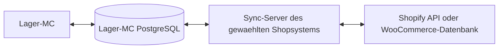

# Gemeinsame Grundlage fuer Shopify und WooCommerce

Lager-MC waehlt genau ein Shopsystem pro Installation und Datenbank:
`shopify` oder `woocommerce`. Die Oberflaeche, Artikelpflege, Bestellungen,
Kunden, Standorte und Versandjobs verwenden denselben Datenbankvertrag.
Der Shopify-Adapter ist auf diesen Vertrag umgestellt. Der WooCommerce-Sync-Server
und die WordPress-Datenbankbruecke sind implementiert; die Auswahl allein importiert
keine Daten. Einrichtung: [WooCommerce-Sync](woocommerce-sync.md).

## Kommunikationsweg



Shop-Zugangsdaten gehoeren ausschliesslich zum jeweiligen Sync-Server.
Lager-MC liest Snapshots und schreibt Aenderungsauftraege in PostgreSQL.
Es importiert keinen Shop-API-Client und startet keinen Sync-Prozess.
Direkte Verbindungen zu Versanddienstleistern, Druckern und einem konfigurierten
Logo bleiben Teil der Lager- und Versandfunktionen.

## Installation

Der gefuehrte Installer bietet die Shopauswahl an. Fuer automatisierte Aufrufe:

```bash
bash scripts/install-standalone-de.sh --shop-system woocommerce --mode complete
bash scripts/install-linux.sh --shop-system woocommerce
bash scripts/install-from-github.sh --branch develop --shop-system woocommerce
```

Ohne explizite Auswahl bleibt beim Update das bisherige Shopsystem erhalten.
Der Linux-Installer fragt bei interaktivem Aufruf nach dem System und uebernimmt
bei nichtinteraktivem Aufruf die bestehende Einstellung (Altbestand: Shopify).
Die Auswahl steht in `settings.local.json` als `shop_system`.

Bei WooCommerce wird kein Shopify-OAuth gestartet und keine Shopify-Konfiguration
angelegt. Ein eigener Sync-Server muss die Lager-MC-PostgreSQL-Datenbank bedienen
und die Daten mit der WooCommerce-Datenbank abgleichen. Die Remote-Anbindung erfolgt
ueber drei eigene WordPress-Brueckentabellen; Bestellspeicherung und Schreibregeln
sind in [WooCommerce-Sync](woocommerce-sync.md) beschrieben.

Die Datenbank speichert ihre Bindung in `shop_configuration` (`id = 1`).
Lager-MC prueft die Bindung vor dem Eintritt in die Arbeitsoberflaeche.
Der Shopify-Sync prueft sie beim Start und vor jedem Synchronisationsdurchlauf;
bei `woocommerce` bricht er vor Shopanfragen und Versandverarbeitung ab.
Die direkte Shopify-Fulfillment-CLI prueft ebenfalls die Datenbankbindung.
Ein laufendes System darf nicht durch manuelles Aendern dieser Bindung umgeschaltet werden.

## Update einer bestehenden Shopify-Installation

1. Datenbank sichern und Lager-MC sowie Sync-Server anhalten.
2. Lager-MC und Shopify-Sync gemeinsam auf diesen Code aktualisieren.
3. `python scripts/run_db_migrations.py` mit der bisherigen Shopify-Konfiguration
   ausfuehren. Beim separat installierten Sync geht auch dessen `run_db_migrations.py`.
4. `SHOPIFY_LOCATION_ID` im Sync konfigurieren, falls bisher nur die alte feste Fallback-ID verwendet wurde. Beide Prozesse wieder starten.

Die Migration laeuft in einer Transaktion und wird durch eine Datenbanksperre
gegen parallele Migrationen geschuetzt. Sie benennt bestehende Tabellen und Spalten um,
haelt IDs, Bestellungen, Artikel, Bestand, Fremdschluessel, Versandhistorie und offene
Jobs bei und kann wiederholt ausgefuehrt werden. Numerische alte Produkt-IDs werden
in Text ueberfuehrt. Die Statuswerte `shopify_pending` und `shopify_error` werden
zu `shop_pending` und `shop_error`.

Vorhandene `shopify_*`-Einstellungen werden beim Einlesen auf `shop_*` abgebildet.
Neue Schluessel haben Vorrang, wenn beide Formen in derselben Datei stehen.
Lokale Einstellungen haben weiterhin Vorrang vor Projekteinstellungen.
Beim Speichern werden die neutralen Schluessel geschrieben.

Die alten Programmversionen koennen die umbenannten Tabellen nicht verwenden.
Die Migration legt keine parallelen, leeren Ersatzdaten fuer Altbestand an.
Wenn alte und neue Tabellen oder Spalten gleichzeitig existieren, wird abgebrochen.
Shopify-Altbestand wird auch bei angeforderter WooCommerce-Auswahl abgelehnt.

Der Shopwechsel erfolgt ueber eine separate WooCommerce-Lagerdatenbank.
Shopify- und WooCommerce-Datenbanken verwenden getrennte Shop-IDs.
