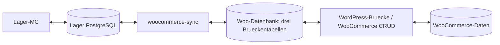

# WooCommerce-Datenbank-Sync

Der neue Worker liegt unter `woocommerce-sync/`. Lager-MC spricht weiterhin nur
mit seiner PostgreSQL-Datenbank. Der Worker verbindet PostgreSQL mit drei eigenen
Tabellen in der WooCommerce-MySQL/MariaDB-Datenbank. Das mitgelieferte
WordPress-Plugin liest und schreibt WooCommerce-Objekte ueber deren CRUD-Schicht.
Es bietet keinen HTTP-Endpunkt und stellt keine Verbindung zu Lager-MC her.
Der Worker verwendet weder REST noch direkte Schreibzugriffe auf WooCommerce-Kerntabellen.



Diese Aufteilung ist fuer korrektes Verhalten von Caches, Hooks und
unterschiedlichen Bestellspeichern erforderlich. Sie folgt WooCommerces
[CRUD-Empfehlung](https://developer.woocommerce.com/docs/best-practices/data-management/crud-objects/).
[HPOS und die aeltere WordPress-Bestellspeicherung](https://developer.woocommerce.com/docs/features/orders/high-performance-order-storage/)
werden durch dieselben WooCommerce-Objekte bedient.

## Einrichtung

1. Lager-MC fuer `woocommerce` mit einer eigenen, leeren PostgreSQL-Datenbank
   installieren. Keine bestehende Shopify-Datenbank umetikettieren.
2. Den Ordner `woocommerce-sync/wordpress/lager-mc-db-bridge/` nach
   `wp-content/plugins/` kopieren und das Plugin in WordPress aktivieren.
   PHP >= 8.1 ist erforderlich. Fuer die erste Version WooCommerce 10.7.x
   verwenden; die native Fulfillment-Schnittstelle ist versionsabhaengig.
3. Im Worker-Verzeichnis `.env.example` nach `.env` kopieren und PostgreSQL-
   sowie Woo-Datenbankzugang eintragen. Die Komplettinstallation bereitet
   die PostgreSQL-Werte bereits vor und behaelt vorhandene `.env`-Dateien bei.
   `WOO_TABLE_PREFIX` muss dem WordPress-Tabellenpraefix entsprechen.
   Bei entferntem MySQL `WOO_DB_SSL_CA` fuer gepruefte TLS-Verbindungen setzen.
4. Einen separaten Datenbankbenutzer verwenden. Der Worker benoetigt auf der
   Woo-Seite ausschliesslich folgende Rechte (Praefix und Datenbank anpassen):

   ```sql
   GRANT SELECT, UPDATE ON wordpress.wp_lager_mc_info TO 'lager_sync'@'SYNC_HOST';
   GRANT SELECT, UPDATE ON wordpress.wp_lager_mc_events TO 'lager_sync'@'SYNC_HOST';
   GRANT SELECT, INSERT ON wordpress.wp_lager_mc_commands TO 'lager_sync'@'SYNC_HOST';
   ```

   Benutzer/Passwort werden separat durch den Datenbankadministrator angelegt.
   Keine Rechte auf Bestell-, Produkt- oder WordPress-Kerntabellen erforderlich.
5. Im Repository-Stamm:

   ```bash
   python3 -m venv .venv
   .venv/bin/pip install -r woocommerce-sync/requirements.txt
   .venv/bin/python woocommerce-sync/woocommerce_sync.py migrate
   .venv/bin/python woocommerce-sync/woocommerce_sync.py doctor
   .venv/bin/python woocommerce-sync/woocommerce_sync.py once
   .venv/bin/python woocommerce-sync/woocommerce_sync.py run
   ```

   `migrate` braucht nur PostgreSQL; die normale Lager-MC-Migration installiert
   das Woo-Schema ebenfalls. `doctor` prueft den Datenbanktransport und zeigt
   die von der WordPress-Bruecke gemeldeten Faehigkeiten, ohne Shopdaten zu aendern.
   Docker: `docker build -f woocommerce-sync/Dockerfile -t lager-woo-sync .`,
   anschliessend mit `--env-file woocommerce-sync/.env` betreiben.
   Fuer systemd liegt `woocommerce-sync/woocommerce-sync.service.example` bei;
   Pfade und Dienstbenutzer anpassen und dessen Leserecht fuer `.env` sicherstellen.
6. WordPress muss `lager_mc_tick` regelmaessig ausfuehren. Ein mehr als
   `WOO_BRIDGE_MAX_AGE` Sekunden alter Bruecken-Heartbeat wird als Fehler gemeldet
   (Standard: 300 Sekunden). WP-Cron plant jede
   Minute einen Lauf; auf wenig besuchten Shops einen echten Cronjob einrichten,
   beispielsweise mit `wp cron event run lager_mc_tick`. Ohne laufenden
   WordPress-Cron werden weder Erstexport noch Schreibauftraege abgearbeitet.
   Der erste Export erfolgt in Batches; bis er fertig ist, meldet der Worker
   `initializing` und gibt keine Lager-Schreibauftraege frei.
7. Zunaechst `WOO_SYNC_MODE=read-only` verwenden. Zum Schreiben zusaetzlich
   `define('LAGER_MC_ALLOW_WRITES', true);` in `wp-config.php` und
   `WOO_SYNC_MODE=read-write` beim Worker setzen. Die Zwei-Seiten-Freigabe
   verhindert versehentliche Shopaenderungen bei der ersten Verbindung.

`read-only` bedeutet: keine Aenderung an WooCommerce-Produkten oder Bestellungen.
Die Brueckentabellen werden weiterhin fuer Bindung und Empfangsbestaetigungen
aktualisiert. Beide Datenbanken werden dauerhaft ueber Store-/Client-UUIDs
aneinander gebunden; eine andere Kombination wird abgelehnt. Nach dem Kopieren
eines Shops fuer Staging diese Bindungen nur mit angehaltenen Workern und
gezielt neu initialisieren; eine Datenbankkopie uebernimmt auch die UUIDs.

## Was bereits funktioniert und was sich unterscheidet

| Bereich | Verhalten / Grenze |
| --- | --- |
| Artikel und Varianten | Import sowie Rueckschreiben bestehender einfacher Produkte und Varianten: SKU, Beschreibung, Preise, Gewicht, Status, Barcode und bedingt Kosten. Interne IDs bleiben bei SKU-Aenderungen stabil. Variablen Elternprodukte werden nicht als eigener Lagerartikel importiert. Name/Status einer Variante gehoeren in Woo zum Elternprodukt; abweichende Aenderungen werden abgelehnt. |
| Lagerstandorte | WooCommerce-Core hat keinen Shopify-Location-/Fulfillment-Order-Vertrag. Die Bruecke erzeugt genau `wc:location:main`. Mehrlager-Erweiterungen benoetigen spaeter eigene Adapter; Lagerplaetze innerhalb von Lager-MC bleiben moeglich. |
| Mengen und Verfuegbarkeit | Eigene Bestandsverwaltung je einfachem Produkt/Variante, ganze nichtnegative Stueckzahlen, keine Backorders. Gemeinsamer Elternbestand, Bundles, Subscriptions und pluginabhaengige Bestandsmodelle werden nicht geschrieben. Checkout-Reservierungen werden importiert; physischer Bestand wird aus Woo-Verkaufsbestand plus noch unversandten, bereits abgezogenen Bestellmengen rekonstruiert. Woo bietet keine exakte Entsprechung aller Shopify-Zustaende wie damaged/safety_stock. |
| Bestellungen und Zahlung | Import inklusive Gastkunden, Positionen, Rueckerstattungsmengen, Adresse, Bezahlstatus und offenen Versandmengen. `processing`/`on-hold` koennen bereits abgezogenen Bestand haben; `on-hold` wird nicht automatisch als bezahlt behandelt. Bezahlstatus folgt dem Zahlungsdatum. |
| Teilversand und Tracking | Mit aktivierten nativen Fulfillments >= 10.7: einzelne Positionen/Mengen, Sendungsnummer und Trackinglink. Ohne diese Funktion werden Bestellungen importiert, Schreibjobs aber sichtbar abgelehnt. Vorhandene Entwurfs-Fulfillments gelten als bereits zugeordnet und werden nicht doppelt versandt. Aeltere Tracking-Plugins speichern andere Metadaten und sind noch nicht angebunden. Die Bruecke aendert den Zahlungs-/Bestellstatus nicht automatisch auf `completed`. |
| Kundenbenachrichtigung | Die erste Version bestaetigt Versand ohne explizite E-Mail-Ausloesung. Jobs mit `notify_customer=true` schlagen mit Begruendung fehl. WooCommerce kann solche E-Mails grundsaetzlich; eine dauerhafte, wiederholbare Mail-Warteschlange fehlt hier noch. Andere installierte Plugins koennen eigene Hooks/Mails ausloesen. |
| Barcode | Woo verwendet global unique IDs fuer GTIN/EAN/UPC/ISBN und prueft deren Format/Einmaligkeit; beliebige Shopify-Barcode-Texte sind nicht gleichwertig. Ungueltige Werte werden als Fehler angezeigt. |
| Einkaufspreis | Nur bei aktiviertem WooCommerce-COGS. Variantenkosten werden als absoluter Wert gesetzt, nicht als Zuschlag auf den Elternpreis. Ohne COGS wird eine Kosten-Aenderung abgelehnt. |
| Preise | Lager-MC bleibt auf EUR beschraenkt; andere Shop-/Bestellwaehrungen werden abgelehnt. Shopify-Compare-at wird als Woo-Regular/Sale-Preis abgebildet. Geplante Sale-Preise muessen in Woo bearbeitet werden; normale Artikelpflege erhaelt deren Zeitplan. Woo-Steuer-/Preisanzeige folgt weiterhin der Shopkonfiguration. |
| Produktanlage / Kategorien | Noch nicht umgesetzt, wie fuer diesen Schritt vereinbart. Ein `create`-Auftrag meldet diese Grenze. Spaetere Erstbefuellung und Shopify-Kategorieuebernahme sind gesonderte Schritte. |

WooCommerce dokumentiert [native Fulfillments und Teilversand](https://woocommerce.com/document/order-fulfillment/),
die [Schnittstelle ab 10.7](https://developer.woocommerce.com/2026/04/15/woocommerce-10-7/),
[Bestellstatus und Bestandsabzug](https://woocommerce.com/document/managing-orders/order-statuses/)
sowie [COGS](https://developer.woocommerce.com/2025/05/21/cost-of-goods-soldcogs-is-ready-to-blossom-out-of-beta-this-summer/).
Diese WooCommerce-Faehigkeiten sind von den bewusst engeren Grenzen dieses Adapters zu unterscheiden.

## Ausfaelle, Konflikte und Betrieb

- Der Worker haelt eine PostgreSQL-Session-Sperre; zwei Worker fuer dieselbe
  Lagerdatenbank werden abgewiesen. Die Bruecke serialisiert Export/Cron ueber
  eine MariaDB/MySQL-Sperre.
- Remote-Ereignisse werden erst nach erfolgreichem PostgreSQL-Commit quittiert.
  Wiederholung und verspaetet committete Ereignisse koennen aeltere Snapshots
  nicht ueber neuere schreiben. Es gibt keinen verlusttraechtigen Sequenz-Cursor.
- Lokale Dirty-Felder bleiben beim Import erhalten. Bestellbindungen werden
  trotzdem aktualisiert. Remote-Schreibjobs liegen vor dem Versand dauerhaft
  in einer PostgreSQL-Outbox; deterministische Auftrags-IDs verhindern doppelte
  Uebermittlung nach Abstuerzen.
- Bestandsauftraege pruefen den erwarteten Woo-Bestand unter einer Datenbanksperre,
  Produktauftraege einen Fingerprint. Ein Konflikt wird als Fehler gespeichert;
  dieselbe lokale Version wird nicht automatisch mit neuen Erwartungen erneut
  abgeschickt. Nach Pruefung eine neue Lageraenderung speichern.
- Bestaetigungen loeschen Dirty-Flags nur fuer die passende lokale Version
  und erst nachdem der zugehoerige Remote-Snapshot eingetroffen ist.
- Shopmutation, Ereignis und Remote-Auftragsbestaetigung laufen gemeinsam in
  einer Transaktion. Schreiben verlangt InnoDB fuer die WordPress-Tabellen.
  Drittanbieter-Hooks mit externen Nebenwirkungen sind nicht transaktional;
  fuer solche Erweiterungen muss die Verträglichkeit im Zielshop geprueft werden.
- Fehler sind in `service_runtime_state`, `woocommerce_sync_commands`,
  Produkt-Syncfehlern bzw. Versandjobs sichtbar. Die Bruecke protokolliert
  unter der Woo-Logger-Quelle `lager-mc-bridge`.
- Hooks exportieren nach Ende eines WordPress-Requests; ein taeglicher kompletter
  Export repariert verpasste Updates. Harte Prozessabbrueche koennen insbesondere
  einen Loesch-Hook verlieren; die erste Version besitzt noch keinen vollstaendigen
  Abgleich verschwundener IDs. Loeschungen im normalen Woo-Prozess werden exportiert.
- Quittierte Ereignisse werden nach sieben Tagen geloescht. Auftragsprotokolle
  bleiben fuer Idempotenz erhalten; fuer grosse Shops spaeter Retention/Archivierung
  mit Abgleich der lokalen Outbox ergaenzen. Datenschutz/Backups gelten fuer beide DBs.

## Pruefungen

```bash
python3 -m unittest discover -s tests -p test_woocommerce_sync.py -q
LAGER_MC_TEST_DSN='host=/test/socket dbname=postgres user=testuser' \
  python3 -m unittest discover -s tests -p test_woocommerce_database_integration.py -q
```

Die PostgreSQL-Tests erstellen eigene zufaellig benannte Datenbanken.
Der PHP-Integrationstest `tests/woocommerce_bridge_integration.php` verlangt eine
isolierte WordPress-Installation und die Markierungsdatei `.lager-mc-test-instance`.
Er erzeugt Testartikel/Bestellungen und ist niemals gegen einen produktiven Shop auszufuehren.
Ein Zielshop mit dessen realen Plugins, Steuereinstellungen und Cron muss vor dem
produktiven Schreibbetrieb zusaetzlich geprueft werden.

Vollstaendiger Datenbanktransport-Test mit den opt-in Variablen
`LAGER_MC_WOO_TEST_ROOT`, `LAGER_MC_TEST_PHP`, `LAGER_MC_TEST_DSN`:
`python3 -m unittest discover -s tests -p test_woocommerce_end_to_end.py -q`.
Die Fixture verwendet ausschliesslich die isolierte MariaDB unter
`/tmp/lager-woo-mysql/test.sock`, Datenbank `lager_woo_test`. Der PHP-Test
mit `seed` bereitet Artikel und Bestellungen vor; `tick` verarbeitet den Inbox-Lauf.
